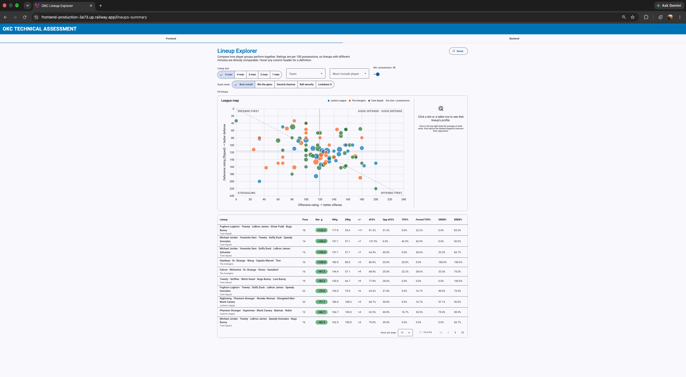
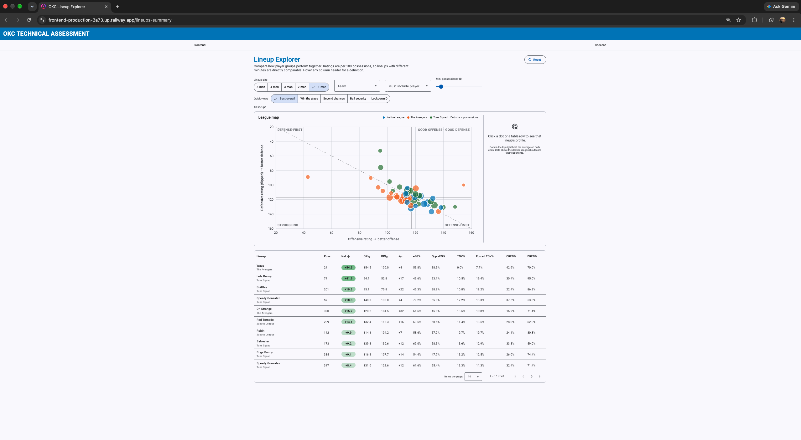

# NBA Lineup Analytics Platform

A full-stack basketball analytics tool that turns raw play-by-play possession data into lineup-level performance metrics, so a coaching staff can find which player combinations actually win their minutes.

**Live demo:** https://frontend-production-3a73.up.railway.app/lineups-summary
**API:** https://backend-production-14b2e.up.railway.app/api/v1/lineups



---

## What it does

- **Aggregates any lineup size (1–5 players).** Every possession lists the five players on each side. The backend generates every 1-, 2-, 3-, 4-, or 5-player combination and totals its offensive and defensive stats across all 1,348 possessions.
- **Computes 10 advanced metrics** on top of the raw totals:

  | Metric | Meaning |
  |---|---|
  | Offensive / Defensive Rating | Points scored / allowed per 100 possessions |
  | Net Rating | ORtg − DRtg: how much a lineup outscores opponents per 100 possessions |
  | Plus/Minus | Raw point differential |
  | Offensive / Defensive eFG% | Shooting efficiency that credits 3-pointers for their extra point |
  | Offensive / Defensive TOV% | Share of possessions ending in a turnover |
  | OREB% / DREB% | Share of available rebounds the lineup grabbed |

- **Filters and ranks** by team, by player, by minimum sample size, and by any metric, ascending or descending.
- **Presents it for decision-makers** through a coach-facing Angular interface:
  - **Lineup Explorer:** a sortable, paginated table with lineup-size toggle, team and player filters, a minimum-possessions slider, color-coded net rating, and plain-language tooltips on every column.
  - **Quick views:** one-click answers to common questions (*Best overall*, *Win the glass*, *Second chances*, *Ball security*, *Lockdown D*).
  - **League map:** a scatter plot of offensive vs. defensive rating (dot size = possessions, color = team). Click any lineup to open a detail panel.



---

## Architecture

```
Browser ──► Angular (TypeScript) ──HTTP GET──► Django REST API ──ORM──► PostgreSQL
            filters → query params             aggregation + metrics     possessions,
            ◄────────────── JSON ◄──────────── sorting + filtering       players, teams
```

Example request:

```
GET /api/v1/lineups?lineup_size=5&min_possessions=10&sort_by=net_rating&order=desc
```

| Query param | Default | Description |
|---|---|---|
| `lineup_size` | `5` | Players per lineup (1–5) |
| `team_id` | — | Only this team's lineups |
| `player_id` | — | Only lineups that include this player |
| `min_possessions` | `0` | Hide small-sample lineups |
| `sort_by` | `total_possessions` | Any numeric field, e.g. `net_rating`, `dreb_pct` |
| `order` | `desc` | `asc` or `desc` |

### How the aggregation works

1. Load every possession in a single query, along with player and team name lookups.
2. For each possession, sort the five player IDs and generate all `n`-player combinations with `itertools.combinations`.
3. Key each combination by `(team, players)` and add the possession's 23 counting stats to its offensive or defensive totals.
4. Derive percentages and advanced metrics, then apply filters and sorting.

Each possession's stats are recorded from the offense's point of view. On a lineup's defensive possessions, `rebounds_defense` counts rebounds *the lineup* secured, and `rebounds_offense` counts second chances it *allowed*. The rebounding metrics account for this.

---

## Tech stack

| Layer | Technologies |
|---|---|
| Backend | Python 3.12, Django 5.2, Django REST Framework, django-cors-headers, WhiteNoise, Gunicorn |
| Database | PostgreSQL (ArrayField for on-court player IDs), psycopg2, dj-database-url |
| Frontend | TypeScript, Angular 21, Angular Material, RxJS, SCSS, hand-built SVG charts |
| Deployment | Railway (PostgreSQL, backend, and frontend as three services), Express static server |
| Testing | Django test framework |

---

## Testing

The metric math is verified against a hand-built three-possession league where every expected number can be checked on paper:

```bash
cd backend
python manage.py test app
```

---

## Running locally

**Prerequisites:** PostgreSQL, Python 3.12, Node.js 22

### 1. Database

```bash
createuser okcapplicant --createdb
createdb okc
psql okc
```

```sql
create schema app;
alter user okcapplicant with password 'thunder';
grant all on schema app to okcapplicant;
```

### 2. Backend

```bash
cd backend
python -m venv .venv && source .venv/bin/activate
pip install -r requirements.txt
python manage.py migrate
PYTHONPATH=. python scripts/ingest_raw_data.py   # load possession data
python manage.py runserver                       # http://localhost:8000
```

### 3. Frontend

```bash
cd frontend
npm install
npm start                                        # http://localhost:4200/lineups-summary
```

---

## Project structure

```
backend/
  app/helpers/lineups.py      # aggregation engine + advanced metrics
  app/views/lineups.py        # API view and query-param parsing
  app/tests/test_lineups.py   # metric tests
  app/dbmodels/models.py      # Team, Player, Game, Possession models
  raw_data/                   # source possession data (JSON)
  scripts/ingest_raw_data.py  # loads raw data into PostgreSQL
frontend/
  src/app/lineups-summary/    # Lineup Explorer + League map UI
  src/app/_services/          # API service and TypeScript interfaces
```

---

## Insights from the data

Using the tool on this league's 1,348 possessions:

- **Best 5-man lineup:** Foghorn Leghorn, Tweety, LeBron James, Elmer Fudd, and Bugs Bunny (Tune Squad) post a **+122.2 net rating** (min. 10 possessions). They scored 177.8 and allowed 55.6 per 100 possessions.
- **Most impactful player:** Dr. Strange (The Avengers) leads the league in plus/minus (+32 over 320 possessions), with a **+34.4 on/off swing**: the team is +15.7 with him and −18.7 without him.
- **Best counter to a big, glass-crashing team:** Sniffles, Witch Hazel, LeBron James, Bugs Bunny, and Lola Bunny (Tune Squad) grab **92.9% of defensive rebounds** (league avg. 71.9%) and 31.6% of offensive rebounds (league avg. 28.1%), while staying +30.8 net.

A full walkthrough of the app is in [`screenshots/demo-recording.mov`](screenshots/demo-recording.mov).

---

## Data

The dataset is a small fictional league: 3 teams, 48 players who saw the floor, 7 games, and 1,348 possessions. The teams and players are fictional, so treat the results as a demonstration of the method rather than real scouting.

## Acknowledgments

This project started from a provided starter scaffold: the data models, raw dataset, ingest script, and an empty Django view and Angular shell. The aggregation engine, advanced metrics, API filtering, tests, the full user interface, and the deployment were built on top of it.
